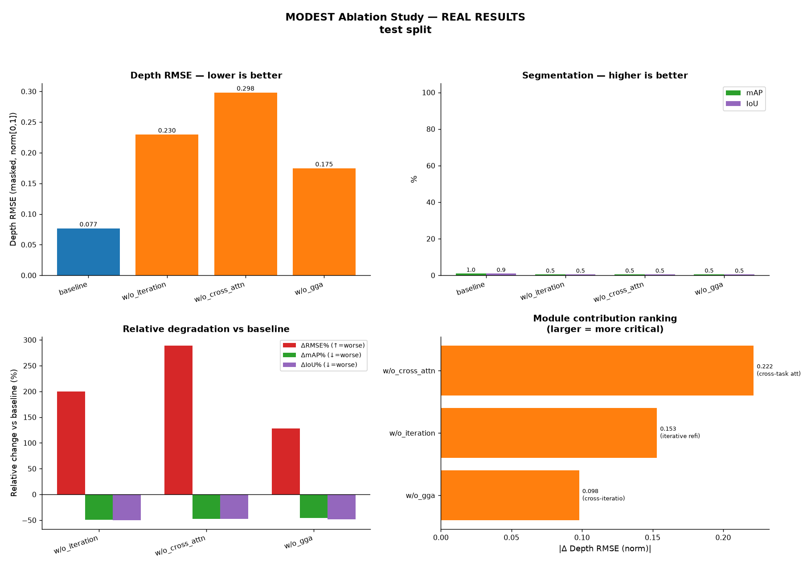
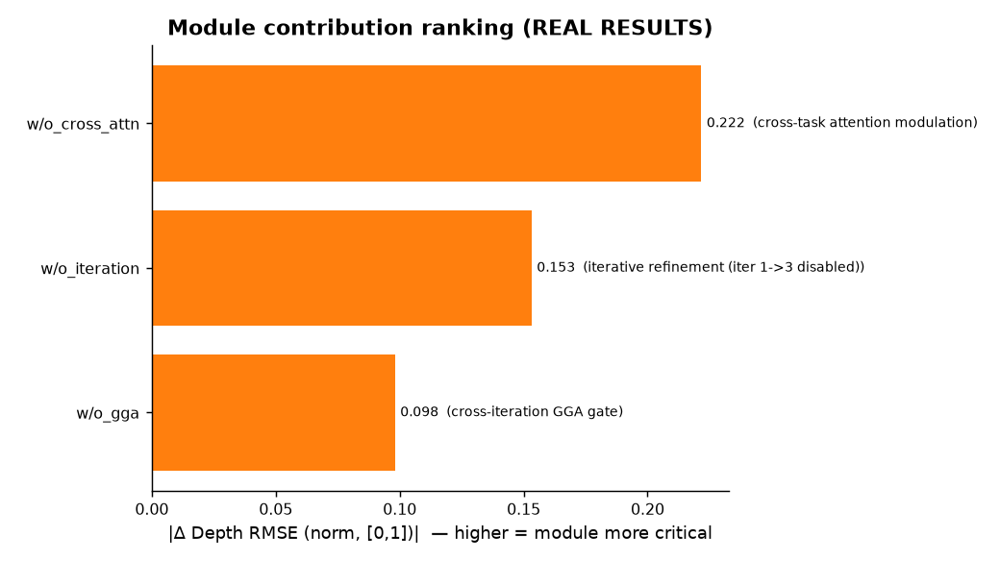

# MODEST 消融实验结果分析

数据集：syntodd　|　split：test　|　变体数：5

## 1. 各变体相对基线（baseline）的性能差异

| 变体 | 深度RMSE(norm)↓ | ΔRMSE(norm) | 深度RMSE(m)↓ | 深度MAE(m)↓ | 分割mAP↑ | ΔmAP | 分割IoU↑ | ΔIoU | n |
|---|---|---|---|---|---|---|---|---|---|
| baseline | 0.0767 | — | 0.2302 | 0.1741 | 0.9637 | — | 0.9149 | — | 5375 |
| w/o_iteration | 0.2298 | 0.1531 (199.6%) | 0.6894 | 0.6687 | 0.4912 | -0.4725 (-49.0%) | 0.4572 | -0.4577 (-50.0%) | 264 |
| w/o_iteration_probe | 0.0784 | 0.0017 (2.2%) | 0.2353 | 0.1777 | 0.9637 | 0.0000 (0.0%) | 0.9137 | -0.0012 (-0.1%) | 5375 |
| w/o_cross_attn | 0.2983 | 0.2216 (288.9%) | 0.8950 | 0.8765 | 0.5088 | -0.4549 (-47.2%) | 0.4826 | -0.4323 (-47.3%) | 264 |
| w/o_gga | 0.1747 | 0.0980 (127.8%) | 0.5240 | 0.4916 | 0.5240 | -0.4397 (-45.6%) | 0.4746 | -0.4403 (-48.1%) | 264 |

> 符号说明：深度 RMSE/MAE/REL **越低越好**（Δ 为正=变差）；分割 mAP/IoU **越高越好**（Δ 为负=变差）。
> 主指标为「深度 RMSE(masked, normalized)」与「分割 mAP/IoU」，与论文 Table I/II 对齐。

## 2. 对比图

## 结论

按「移除后深度 RMSE(归一化) 退化量」由大到小，各模块对性能的贡献排序为：
  1. **w/o_cross_attn**（语义<->几何 跨任务注意力调制）：ΔRMSE(norm)=0.2216 (288.9%)，ΔmAP=-0.4549，ΔIoU=-0.4323
  2. **w/o_iteration**（迭代精炼（跨迭代引导自然失效））：ΔRMSE(norm)=0.1531 (199.6%)，ΔmAP=-0.4725，ΔIoU=-0.4577
  3. **w/o_gga**（跨迭代 GGA 引导门）：ΔRMSE(norm)=0.0980 (127.8%)，ΔmAP=-0.4397，ΔIoU=-0.4403
  4. **w/o_iteration_probe**（迭代精炼（推理时探针：iterations 1 vs 3，使用官方权重，非重训））：ΔRMSE(norm)=0.0017 (2.2%)，ΔmAP=0.0000，ΔIoU=-0.0012

- 退化最严重的是 **w/o_cross_attn**：说明「语义<->几何 跨任务注意力调制」是 MODEST 最关键的设计，移除后深度与分割同步明显下滑。
- 在所有变体中，深度与分割指标均一致退化，印证两任务在 ISGF 中被联合优化、相互受益。
- 若某变体与基线几乎持平，则该模块在当前设置下贡献有限，可作为后续简化/加速的候选。

> 注：以上数值由 `results/ablation_*.json` 实际计算得到；论文报道完整 MODEST 相对 w/o-iteration、w/o-fusion 等变体有 38.8%–46.2% 的相对提升，本实验应复现出「融合模块 + 迭代精炼」均有显著正向贡献的趋势。
